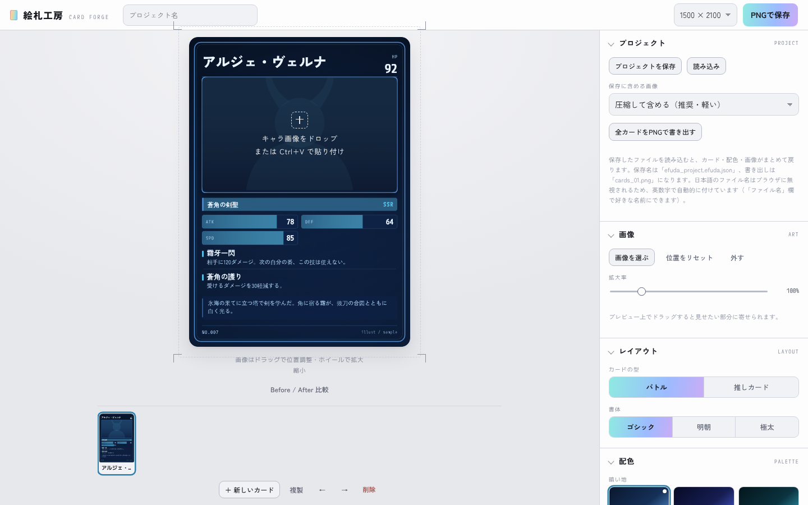

# 絵札工房 — CARD FORGE

キャラクターのイラストから、トレーディングカード風の画像をつくるツールです。
ブラウザだけで動き、サーバーもインストールもいりません。

**▶ https://ikemenngitarisuto-cpu.github.io/efuda-kobo/**

## できること

- **カードの型**: バトル（ステータスと技が並ぶ型）と推しカード（イラストを全面に出す型）、書体は3種類
- **配色**: 24種類のプリセット（暗い地12・明るい地8・箔4）と自由配色。地・パネル・枠・アクセント・文字などを、役割ごとに個別に指定することもできます
- **地・枠・質感**: 模様9種類、枠6種類、質感（ホロ・箔スジ・紙目）
- **イラストから配色をつくる**: 画像から主な色を拾い、それに合うUIの配色を3案出します
- **解析**: アクセント色の使いすぎや、文字と背景のコントラスト不足をチェックします
- **ステータスと技**: ステータスは7項目まで、技は4つまで
- **複数カードの管理**: 1つのプロジェクトに何枚でも作れます。複製や並べ替えもできます
- **書き出し**: PNG（750×1050 / 1500×2100 / 2250×3150）。全カードをZIPでまとめて書き出すこともできます
- **プロジェクトの保存**: カード、配色、画像をJSONファイル1つに保存し、あとで読み込めます

## 使い方

- **Web**: 上のURLを開くだけで使えます
- **手元のPC**: `index.html` をダウンロードしてブラウザで開いてもそのまま動きます。全カードをZIPにまとめる機能を使う場合は、`vendor` フォルダも同じ場所に置いてください

画像はドラッグ＆ドロップ、Ctrl+V（貼り付け）、「画像を選ぶ」ボタンのどれでも読み込めます。
プレビュー上でドラッグすると位置を、マウスホイールで大きさを調整できます。

## データの扱い

- 画像や入力内容がサーバーに送られることはありません。処理はすべてブラウザの中で行います
- 入力した文字と配色は、ブラウザ（localStorage）に自動で保存されます。**画像は自動保存に含まれません。** 画像も残したい場合は「プロジェクトを保存」を使ってください
- 自分で保存したテーマも、そのブラウザの中にだけ保存されます

## ファイル構成

| パス | 内容 |
| --- | --- |
| `index.html` | アプリ本体（HTML・CSS・JavaScriptを1ファイルにまとめています） |
| `vendor/jszip.min.js` | 全カードをZIPにまとめるためのライブラリ [JSZip](https://stuk.github.io/jszip/) 3.10.1 |
| `vendor/jszip-LICENSE.markdown` | JSZipのライセンス（MITとGPLv3のデュアルライセンス） |
| `docs/screenshot.png` | このREADMEに載せている画面写真 |

フォントは Google Fonts から読み込んでいます（Zen Kaku Gothic New、Shippori Mincho、Dela Gothic One、M PLUS 1 Code。いずれも SIL Open Font License）。
インターネットにつながっていない環境では、OSに入っているフォントで表示されます。

## ライセンス

[MIT License](LICENSE) です。
同梱しているJSZipは、それ自体のライセンス（`vendor/jszip-LICENSE.markdown`）に従います。
